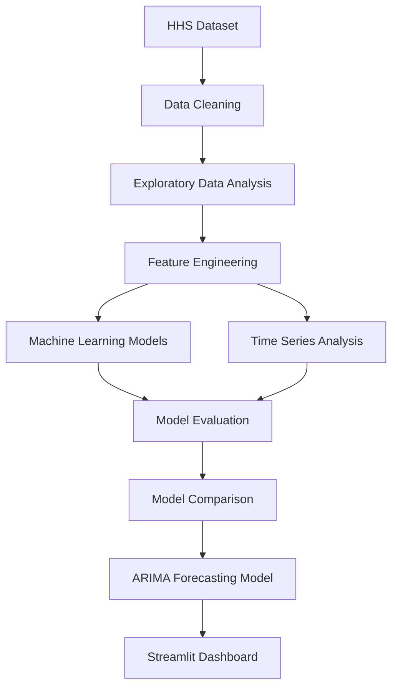
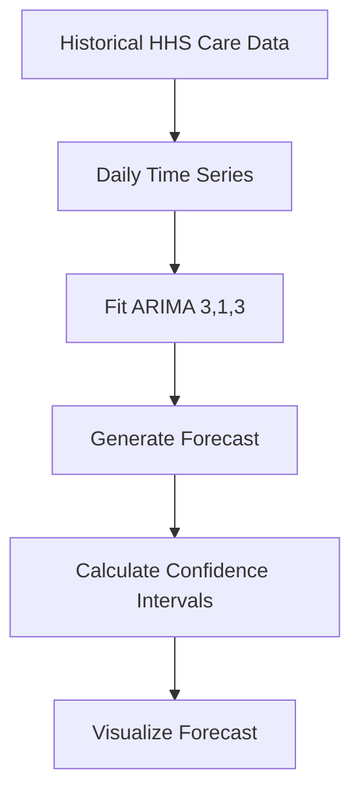

# 📊 Care Transition Efficiency & Placement Outcome Analytics

\<p align="center">   \<strong>Data Analytics • Machine Learning • Time Series Forecasting • Streamlit\</strong> \</p>

\<p align="center">   \<a href="[https://care-transition-analytics-2jkqewg2ozdtjdyy8f8svx.streamlit.app/](https://care-transition-analytics-2jkqewg2ozdtjdyy8f8svx.streamlit.app/)">     \<strong>🚀 Live Dashboard\</strong>   \</a>   &nbsp; • &nbsp;   \<a href="[https://github.com/manmeetmanchanda10016/Care-Transition-Analytics](https://github.com/manmeetmanchanda10016/Care-Transition-Analytics)">     \<strong>💻 GitHub Repository\</strong>   \</a> \</p>

\<p align="center">   ![Python]\([https://img.shields.io/badge/Python-3.10%2B-blue?logo=python](https://img.shields.io/badge/Python-3.10%2B-blue?logo=python))   ![Streamlit]\([https://img.shields.io/badge/Streamlit-Dashboard-FF4B4B?logo=streamlit](https://img.shields.io/badge/Streamlit-Dashboard-FF4B4B?logo=streamlit))   ![Pandas]\([https://img.shields.io/badge/Pandas-Data%20Analysis-150458?logo=pandas](https://img.shields.io/badge/Pandas-Data%20Analysis-150458?logo=pandas))   ![Scikit Learn]\([https://img.shields.io/badge/Scikit--Learn-ML-F7931E?logo=scikitlearn](https://img.shields.io/badge/Scikit--Learn-ML-F7931E?logo=scikitlearn))   ![Statsmodels]\([https://img.shields.io/badge/Statsmodels-Time%20Series-4051B5](https://img.shields.io/badge/Statsmodels-Time%20Series-4051B5))   ![Plotly]\([https://img.shields.io/badge/Plotly-Visualization-3F4F75?logo=plotly](https://img.shields.io/badge/Plotly-Visualization-3F4F75?logo=plotly)) \</p>

---

## 📌 Project Overview

**Care Transition Efficiency & Placement Outcome Analytics** is a data analytics and time-series forecasting project built to explore trends in the U.S. Department of Health and Human Services (HHS) Unaccompanied Alien Children (UAC) Program.

The project analyzes aggregate population and movement data across the following stages:

- Children apprehended and placed in CBP custody
- Children remaining in CBP custody
- Children transferred out of CBP custody
- Children in HHS care
- Children discharged from HHS care

The objective is to understand historical population patterns, examine relationships between operational indicators, compare forecasting approaches, and develop a dashboard for exploring historical trends and statistical forecasts.

### 🎯 Key Objectives

- Analyze historical trends in the HHS care population.
- Explore relationships between CBP and HHS operational indicators.
- Identify significant changes in population patterns.
- Build and compare machine learning and time-series forecasting models.
- Evaluate forecasting performance using chronological validation.
- Deploy an interactive Streamlit dashboard.

---

## 🖥️ Live Application

\<p align="center">   \<a href="[https://care-transition-analytics-2jkqewg2ozdtjdyy8f8svx.streamlit.app/](https://care-transition-analytics-2jkqewg2ozdtjdyy8f8svx.streamlit.app/)">     \   \</a> \</p>

Explore the dashboard to view historical trends, compare models, and generate forecasts.

---

## 📑 Table of Contents

- [Project Overview](#-project-overview)
- [Dataset](#-dataset)
- [Project Workflow](#-project-workflow)
- [Data Preprocessing](#-data-preprocessing)
- [Exploratory Data Analysis](#-exploratory-data-analysis)
- [Feature Engineering](#-feature-engineering)
- [Techniques Used](#-techniques-used)
- [Models Implemented](#-models-implemented)
- [Model Evaluation](#-model-evaluation)
- [Time Series Forecasting](#-time-series-forecasting)
- [Interactive Dashboard](#-interactive-dashboard)
- [Project Structure](#-project-structure)
- [Installation and Setup](#-installation-and-setup)
- [Limitations](#-limitations)
- [Future Improvements](#-future-improvements)
- [Author](#-author)

---

## 📂 Dataset

**Source:** HHS Unaccompanied Alien Children Program

**File:** `HHS_Unaccompanied_Alien_Children_Program.csv`

| Dataset Information                                |                       Value |
| -------------------------------------------------- | --------------------------: |
| Original observations                              |                       1,170 |
| Original columns                                   |                           6 |
| Observations after removing empty rows             |                         720 |
| Date range                                         | Jan 12, 2023 – Dec 21, 2025 |
| Daily time-series observations after interpolation |                       1,075 |
| Target variable                                    |        Children in HHS Care |

### Dataset Features

| Feature                                        | Description                           |
| ---------------------------------------------- | ------------------------------------- |
| Date                                           | Observation date                      |
| Children apprehended and placed in CBP custody | Children entering CBP custody         |
| Children in CBP custody                        | Children currently in CBP custody     |
| Children transferred out of CBP custody        | Children transferred from CBP custody |
| Children in HHS Care                           | Children currently in HHS care        |
| Children discharged from HHS Care              | Children discharged from HHS care     |

---

## 🔄 Project Workflow



---

## 🧹 Data Preprocessing

The dataset was prepared through the following steps:

1. Removed completely empty rows.
2. Converted the date column into datetime format.
3. Sorted observations chronologically.
4. Converted comma-separated numerical values into numeric data types.
5. Checked for missing values and duplicate observations.
6. Created a daily time series using time-based interpolation.
7. Prepared chronological training and testing datasets.

**Important:** The original observations are irregularly spaced. Daily interpolation creates estimated values between recorded dates; these interpolated values should not be interpreted as actual daily measurements.

---

## 📈 Exploratory Data Analysis

The analysis included:

- Time-series trend visualization.
- Distribution analysis.
- Correlation analysis.
- Rolling averages.
- Historical population comparisons.
- Identification of major changes in population levels.
- Before-and-after January 2025 statistical comparison.

### Key Observations

- The HHS care population increased during parts of 2023 and early 2024.
- A substantial decline occurred around January 2025.
- Several operational indicators also showed simultaneous changes.
- Discharges from HHS care had a strong correlation with the HHS care population.

**Note:** Correlation indicates statistical association, not causation. The reason for the observed changes cannot be established from this dataset alone.

---

## ⚙️ Feature Engineering

For machine learning experiments, the following features were generated:

| Feature                | Description                            |
| ---------------------- | -------------------------------------- |
| HHS_lag_1              | Previous observation                   |
| HHS_lag_2              | Population two observations earlier    |
| HHS_lag_3              | Population three observations earlier  |
| Rolling Mean 3         | Average of previous three observations |
| Rolling Mean 7         | Average of previous seven observations |
| Current CBP Indicators | Operational variables                  |
| Target                 | Next recorded HHS care population      |

Rolling features were calculated using shifted values to avoid directly including the current target observation.

---

## 🧠 Techniques Used

\<details>
\<summary>\<strong>1. Data Cleaning and Preprocessing\</strong>\</summary>

- Missing value analysis
- Duplicate detection
- Datetime conversion
- Numeric type conversion
- Time-based interpolation
- Chronological train-test splitting
- Median imputation
- Feature scaling using StandardScaler

\</details>

\<details>
\<summary>\<strong>2. Exploratory Data Analysis\</strong>\</summary>

- Descriptive statistics
- Correlation matrix
- Heatmaps
- Time-series visualization
- Rolling averages
- Distribution analysis
- Structural change exploration
- Welch's two-sample t-test

\</details>

\<details>
\<summary>\<strong>3. Statistical Time Series Analysis\</strong>\</summary>

- Augmented Dickey-Fuller (ADF) Test
- First-order differencing
- Autocorrelation Function (ACF)
- Partial Autocorrelation Function (PACF)
- Akaike Information Criterion (AIC)
- Ljung-Box Test
- Durbin-Watson Test
- Jarque-Bera Test
- Residual analysis
- Forecast confidence intervals

\</details>

\<details>
\<summary>\<strong>4. Model Validation and Optimization\</strong>\</summary>

- Chronological train-test split
- TimeSeriesSplit cross-validation
- GridSearchCV
- Hyperparameter tuning
- Mean Absolute Error (MAE)
- Root Mean Squared Error (RMSE)
- R² Score
- Naive baseline comparison

\</details>

---

## 🤖 Models Implemented

Multiple machine learning and statistical forecasting approaches were experimented with and evaluated.

### A. Machine Learning Models

| Model                       | Library      |
| --------------------------- | ------------ |
| Linear Regression           | Scikit-learn |
| Ridge Regression            | Scikit-learn |
| Lasso Regression            | Scikit-learn |
| Decision Tree Regressor     | Scikit-learn |
| Random Forest Regressor     | Scikit-learn |
| Extra Trees Regressor       | Scikit-learn |
| Gradient Boosting Regressor | Scikit-learn |
| XGBoost Regressor           | XGBoost      |
| LightGBM Regressor          | LightGBM     |

### B. Statistical Time Series Models

| Model             | Configuration / Purpose       |
| ----------------- | ----------------------------- |
| Naive Forecast    | Last observed value           |
| ARIMA             | Multiple candidate orders     |
| ARIMA(2,1,1)      | Conventional ARIMA experiment |
| ARIMA(3,1,3)      | Selected forecasting model    |
| SARIMA            | (1,1,1) × (1,0,1,7)           |
| ARIMAX            | ARIMA with external variables |
| Auto-ARIMA        | Automatic order selection     |
| Holt Linear Trend | Exponential smoothing         |
| Damped Holt Trend | Damped trend forecasting      |

### C. Hyperparameter Optimization

Machine learning models were tuned using:

- GridSearchCV
- TimeSeriesSplit
- Multiple hyperparameter combinations
- MAE-based model selection

---

## 📊 Model Evaluation

Models were evaluated using different validation strategies. The results below should be interpreted within their respective evaluation protocols.

### 1. Machine Learning – Original Irregular Series

| Model             |   MAE |   RMSE |     R² |
| ----------------- | ----: | -----: | -----: |
| Linear Regression | 17.60 |  21.60 | 0.9849 |
| Ridge Regression  | 38.30 |  42.43 | 0.9419 |
| Lasso Regression  | 27.19 |  32.55 | 0.9658 |
| Decision Tree     | 58.66 |  72.98 | 0.8281 |
| Random Forest     | 56.87 |  73.32 | 0.8265 |
| Extra Trees       | 57.22 |  73.03 | 0.8279 |
| Gradient Boosting | 69.65 |  87.55 | 0.7526 |
| XGBoost           | 84.20 | 116.60 | 0.5611 |
| LightGBM          | 70.25 |  92.05 | 0.7265 |

### 2. Time Series – Five-Fold Chronological Validation

The following results use 30-step open-loop test windows.

| Model             | Average MAE | Average RMSE |
| ----------------- | ----------: | -----------: |
| ARIMA(3,1,3)      |       31.55 |        37.98 |
| ARIMA(2,1,1)      |       34.14 |        41.84 |
| Damped Holt       |       35.71 |        45.25 |
| Holt Linear Trend |       84.32 |        98.09 |
| Naive Forecast    |       60.07 |        71.11 |

### 3. Rolling One-Step Evaluation

| Model                                       |  MAE | RMSE |
| ------------------------------------------- | ---: | ---: |
| ARIMA(2,1,1)                                | 4.54 | 6.11 |
| Daily Linear Regression                     | 6.42 | 7.93 |
| SARIMA                                      | 6.88 | 8.62 |
| ARIMAX with actual test exogenous variables | 3.96 | 5.12 |

**Evaluation note:** Rolling one-step evaluation updates predictions using actual observations as they become available. It is not equivalent to forecasting an entire future horizon without observing new data. The ARIMAX result also uses actual test-period external variables, which would not be known in advance in a real future forecast.

---

## 🔮 Time Series Forecasting

The deployed application uses an **ARIMA(3,1,3)** model.

The model was trained on the available historical daily HHS care population series.

Forecasting functionality includes:

- User-selectable forecast horizons.
- 7-day forecast.
- 14-day forecast.
- 21-day forecast.
- 30-day forecast.
- Forecast visualization.
- Confidence intervals.
- Historical versus predicted population comparison.

### Forecasting Workflow



The ARIMA model was selected after comparing multiple candidate configurations and evaluating chronological validation performance. Model-selection results should be interpreted cautiously because the final order was also selected using the full historical series.

---

## 🖥️ Interactive Streamlit Dashboard

The project includes a multi-page Streamlit application.

### Dashboard Pages

| Page             | Functionality                              |
| ---------------- | ------------------------------------------ |
| Dashboard        | Main project overview and key indicators   |
| Data Analysis    | Historical trends and exploratory analysis |
| Model Comparison | Compare forecasting approaches and metrics |
| Forecasting      | Generate forecasts for different horizons  |
| About Project    | Project methodology, scope, and details    |

### Dashboard Features

- Dark-themed interface.
- Interactive Plotly visualizations.
- Historical trend exploration.
- Model performance comparison.
- User-selectable forecast horizon.
- Forecast confidence intervals.
- Automatically loaded dataset and saved model.

---

## 🛠️ Technology Stack

| Category             | Technologies                |
| -------------------- | --------------------------- |
| Programming Language | Python                      |
| Data Manipulation    | Pandas, NumPy               |
| Visualization        | Plotly, Matplotlib, Seaborn |
| Machine Learning     | Scikit-learn                |
| Gradient Boosting    | XGBoost, LightGBM           |
| Statistical Modeling | Statsmodels, pmdarima       |
| Statistical Testing  | SciPy                       |
| Dashboard            | Streamlit                   |
| Model Persistence    | Joblib                      |
| Deployment           | Streamlit Community Cloud   |
| Version Control      | Git, GitHub                 |

---

## 📁 Project Structure

```text
Care-Transition-Analytics/
│
├── app.py
│
├── HHS_Unaccompanied_Alien_Children_Program.csv
│
├── arima_331_model.pkl
│
├── requirements.txt
│
└── README.md
```

---

## 🚀 Installation and Setup

### 1. Clone the Repository

```bash
git clone https://github.com/manmeetmanchanda10016/Care-Transition-Analytics.git
```

### 2. Navigate to the Project Directory

```bash
cd Care-Transition-Analytics
```

### 3. Create a Virtual Environment

```bash
python -m venv venv
```

### 4. Activate the Environment

**Windows:**

```bash
venv\Scripts\activate
```

**Mac/Linux:**

```bash
source venv/bin/activate
```

### 5. Install Dependencies

```bash
pip install -r requirements.txt
```

### 6. Run the Application

```bash
streamlit run app.py
```

The dashboard will open in your browser.

---

## ⚠️ Limitations

- The dataset contains aggregate program-level observations, not individual-level records.
- It cannot predict individual placement outcomes, sponsor reunification, or individual case decisions.
- Daily observations created through interpolation are estimates, not independently recorded daily measurements.
- A substantial change around January 2025 may reflect operational or reporting changes; its cause cannot be determined from the available data.
- Future forecasts are based on historical patterns and may not account for policy, operational, or external changes.
- Forecast accuracy can vary depending on the validation method and forecast horizon.
- The historical dataset ends on December 21, 2025. The deployed model does not automatically incorporate newer observations.

---

## 🔭 Future Improvements

- Integrate regularly updated official datasets.
- Evaluate rolling-origin multi-horizon forecasting.
- Explore additional forecasting architectures.
- Add automated model retraining.
- Improve uncertainty quantification.
- Add more detailed model diagnostics.
- Develop monitoring for forecast performance over time.

---

## 👨‍💻 Author

**Manmeet Singh Manchanda**

Computer Science and Engineering
Thapar Institute of Engineering & Technology
Thapar CSE – 2029 Batch

\<p align="left">
&#x20; \<a href="[https://github.com/manmeetmanchanda10016](https://github.com/manmeetmanchanda10016)">
&#x20;   \
&#x20; \</a>
&#x20; \<a href="[https://www.linkedin.com/in/manmeet-singh-manchanda-7b395a37](https://www.linkedin.com/in/manmeet-singh-manchanda-7b395a37)">
&#x20;   \
&#x20; \</a>
\</p>

---

\<p align="center">   \<strong>Built with Python, Machine Learning, Statistical Analysis and Streamlit.\</strong> \</p>

\<p align="center">   ⭐ If you find this project interesting, consider giving the repository a star! \</p>
